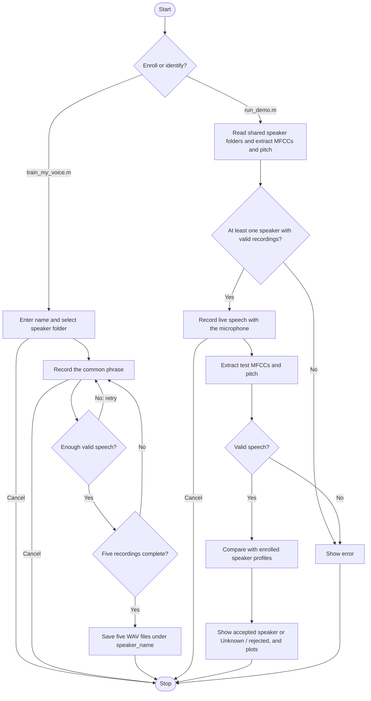

# Speaker Identification in MATLAB

Match a live voice to an enrolled speaker only when it passes strict enrollment checks; otherwise return **Unknown / rejected**. The core workflow uses **four MATLAB files**, plus speaker_match.m for recognition and evaluate_enrollment.m for development checks. Enrollment creates the shared audio-sample folders.

## How It Works

Profiles are calculated in memory from the WAV files every time you run identification. No metadata files or profile database are required. Names come from the speaker folder names.

## Files

| File | Purpose |
|---|---|
| `train_my_voice.m` | Record and save five samples for a named speaker |
| `run_demo.m` | Load speakers, identify new speech, and display results |
| `record_voice.m` | Shared microphone recording with quiet/speak cues |
| `sound_pattern.m` | Filter audio and extract MFCC and pitch features |
| `speaker_match.m` | Multi-template matching with calibrated rejection checks |
| `evaluate_enrollment.m` | Leave-one-out development checks (no microphone needed) |

Enrollment creates `speaker_recordings/speaker_<name>/sample_001.wav` through `sample_005.wav`. The version-controlled example enrollment set contains **two speakers and ten recordings**:

| Speaker | Recording folder | Samples |
|---|---|---|
| Arnav | `speaker_recordings/speaker_arnav/` | 5 |
| Sarvesh | `speaker_recordings/speaker_sarvesh/` | 5 |

These WAV files are included in the repository, so collaborators can pull the same enrollment set and test it with live speech.

## Use

Open the project folder in MATLAB. No additional toolboxes are required.

**To identify a speaker:** run `run_demo.m`, click **Record**, and speak into the microphone when prompted:

> This is my voice for identification.

The result appears in a dialog and the Command Window, with two separate figures shown as tabs in one MATLAB figure window:

- **Speaker identification:** the waveform, the full-record FFT before and after filtering, MFCCs, and matching distances. Lower distances indicate a closer match. The red markers show each speaker’s learned distance limit. A name is shown only after the distance, spectrum, pitch, recording-consistency, and separation checks all pass. Otherwise the result is **Unknown / rejected**; the diagnostic output may show the closest unverified candidate.
- **Speaker mean comparison:** the current voice's mean MFCCs overlaid with each enrolled speaker's means, followed by the signed difference (current mean minus speaker mean) for each coefficient. Values closer to zero indicate similar means. These plots show arithmetic averages of the 13 mean features; identification combines robust median profiles of the 26 MFCC statistics with a voiced-pitch feature. Pitch is also printed in the Command Window.

Each successful run automatically saves `test_signal.png` and `test_comparison.png` beside the code, replacing the previous images. They are figure exports of the actual test input, with its prediction and comparisons. Commit and push these two files to share the latest test figures on GitHub.

### Latest Live Test

These saved figures show an earlier Arnav/Sarvesh live test and predate the strict rejection update. They illustrate the signal-processing plots, not the current acceptance rules or recognition accuracy. A new live run saves replacement figures locally, including the rejection result and red distance-limit markers.

With **one enrolled speaker**, the demo checks whether the live voice matches that enrollment. Both figures show only that speaker. This cannot establish identity against other people. When more people enroll, their bars, distance limits, mean curves, difference bars, and legends are included automatically. The same strict acceptance checks apply with one or multiple speakers.

**To add a speaker:** run `train_my_voice.m`, enter their name, and record five examples. Stay quiet until **SPEAK NOW**, then finish the phrase within four seconds. Poor recordings are retried. Cancelling an unfinished enrollment keeps the existing recordings. Replacing an existing speaker folder requires confirmation.

Names are converted to lowercase folder names: `Arnav Deshpande` becomes `speaker_arnav_deshpande`. Spaces and punctuation become underscores, so use distinct names that produce different folders.

**To share recordings:** commit and push the person's entire speaker folder. Your collaborator pulls the changes and runs `run_demo.m`; the new speaker is included automatically. MATLAB does not push files to GitHub itself.

The live demo has no WAV-file selection option. Enrollment still saves 16 kHz WAV files for sharing. At least one valid enrolled speaker is needed. A folder with missing, unreadable, or invalid recordings is skipped with a warning in the Command Window, allowing the other speakers to run. Use the same phrase and microphone setup for enrollment and testing, and have one person speak at a time.

## Signal Processing

1. Convert audio to mono, remove its mean, and retain 80–7600 Hz using an FFT mask and inverse FFT.
2. Select speech using frame power over 25 ms frames with a 10 ms hop.
3. Apply pre-emphasis, a Hamming window, a 512-point FFT, 26 mel filters, a logarithm, and a DCT.
4. Keep 13 MFCCs, excluding coefficient zero. Their means and standard deviations supply 26 spectral features. Also estimate vocal pitch from normalized autocorrelation of 40 ms speech frames, using lags corresponding to 70–400 Hz. At least 0.15 seconds of periodic voiced frames is required; the median pitch is stored as a base-2 logarithm, giving 27 features in total.
5. Take the coordinate-wise median of each person's five descriptors. Combine scaled MFCC distance (85%) and log-pitch distance (15%), with minimum scale floors of 0.65 MFCC units and 0.18 octave. Use Huber loss for normalized MFCC deviations so a single unusually large coefficient does not dominate the score; calibrate matching and acceptance limits with that same loss. Learn bounded thresholds from within-speaker leave-one-out distances. Compare the live voice to its two nearest enrollment clips and the speaker median. A failed candidate is rejected; another speaker is never selected as a fallback. Suspected inconsistent clips are reported in the Command Window.

The main Signals and Systems connections are discrete-time operations (Unit 1), LTI filtering and convolution (Unit 2), and Fourier analysis (Unit 4). The pre-emphasis difference equation also has a Z-transform interpretation (Unit 6):

$$
y[n]=x[n]-0.97x[n-1],\qquad H(z)=1-0.97z^{-1}.
$$

The finite-record Fourier operations use:

$$
X[k]=\sum_{n=0}^{N-1}x[n]e^{-j2\pi kn/N},\qquad Y[k]=H[k]X[k].
$$

Spectral multiplication corresponds to circular convolution at the DFT length. Pitch estimation adds a time-domain periodicity measurement:

$$
r_x[\ell]=\sum_n x[n]x[n+\ell],\qquad \hat f_0=\frac{f_s}{\ell_{\mathrm{peak}}}.
$$

The implementation normalizes each lag by the overlapping frame energies, accepts correlation peaks of at least 0.65, and chooses the earliest peak at least 90% as strong as the strongest peak. The median frequency over voiced frames reduces occasional pitch errors. This complements the vocal-tract information in MFCCs; pitch alone does not identify a speaker.

For MFCC statistics $\mathbf{m}=[\mu_1,\ldots,\mu_{13},\sigma_1,\ldots,\sigma_{13}]^T$ and $q=\log_2(\hat f_0)$, the updated matching distance is:

$$
 d_s=\frac{0.85}{26}\sum_{i=1}^{26}\rho\left(\frac{m_i-c_{s,i}}{a_i}\right)
 +0.15\left(\frac{q-c_{s,27}}{a_{27}}\right)^2.
$$

Here $\rho(t)=t^2$ when $|t|\le 1$, and $\rho(t)=2|t|-1$ otherwise (Huber loss). This limits one extreme MFCC deviation without ignoring the rest of the spectrum. $c_{s,i}$ is the speaker's coordinate-wise median. The feature scale $a_i$ is the robust median absolute deviation of enrollment-to-speaker residuals, floored at 0.65 (MFCC) or 0.18 octave (log-pitch).

## Rejection and speaker consistency

The matcher considers only the **closest speaker** and never assigns a runner-up as a fallback. It requires:

- **Valid enrollment**: at least three recordings must agree with the speaker's own profile under the leave-one-out check.
- **Bounded speaker distance and MFCC distance**: robust limits derived from leave-one-out enrollment distances, with upper bounds of 3.0 (overall distance) and 2.8 (MFCC distance).
- **Pitch similarity**: log-pitch deviation must be below a speaker-specific bound between 0.22 and 0.32 octave. Pitch is a secondary cue rather than an identity guarantee.
- **Two-nearest recording consistency**: the average distance to the closest two enrollment examples must fit a bounded threshold learned from enrollment pair similarities; at least two examples must also be nearby.
- **Separation**: if several speakers are enrolled, the relative best-versus-second-best distance margin must be at least 0.35.

These thresholds and Huber normalization are experimental engineering heuristics for small educational datasets, **not confidence probabilities or proven security thresholds**. More tolerant matching can lower false rejections but increase false acceptances. Do not use this project as an authentication system.

## Evaluate before claiming accuracy

Run evaluate_enrollment.m in the project folder. It leaves out each saved enrollment recording in turn, builds models from the four remaining recordings, and reports correct identifications, incorrect identifications, and rejections. It also checks whether a held-out recording is incorrectly accepted when its true speaker is removed from the gallery.

This checks only **saved enrollment data** and is optimistic compared with independent testing. To assess live reliability, gather new recordings on multiple occasions and collect voices from people who were never enrolled; report both false rejections and false acceptances. If a person was enrolled twice under different names, merge those recordings under one identity before measuring performance.

MFCCs and classification extend the listed syllabus; Fourier-series and Laplace-transform calculations are not implemented.

This is an educational speaker matcher with explicit rejection, not an authentication system. Feature overlap can still cause false acceptance of an unseen person; five enrollment clips cannot guarantee zero false accepts. Evaluate fresh registered and unregistered voices separately rather than treating enrollment matches as accuracy measurements.
