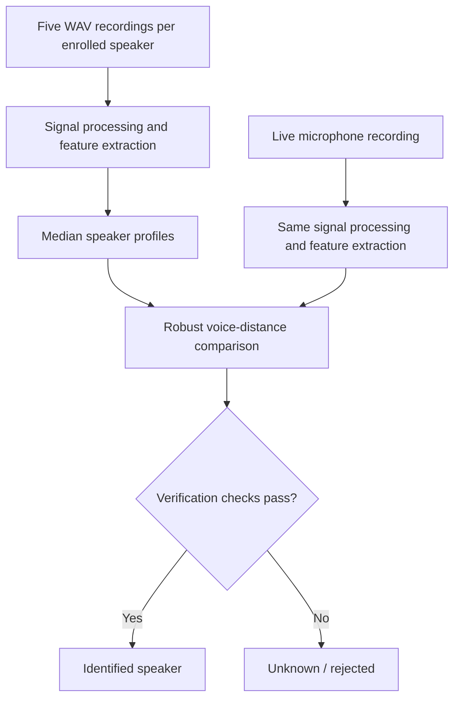

# 🎙️ Speaker Identification in MATLAB

**A Signals & Systems project for speaker identification using digital signal processing, MFCCs, pitch estimation, and explicit unknown-speaker rejection.**

The project compares a live spoken phrase with previously enrolled voice recordings. It returns a speaker's name **only if the match passes its verification checks**; otherwise, it returns **Unknown / rejected**.

> [!NOTE]
> This is an **educational speaker identification system**, not a security-grade voice authentication tool. A closest match is not automatically a verified identity, and the model is not guaranteed to recognize every enrolled speaker.

## ✨ Features

- **Live microphone recording** with clear prompts in MATLAB.
- **Multi-speaker enrollment:** five WAV recordings per person.
- **Signal processing:** FFT filtering, speech-frame detection, pre-emphasis, MFCCs, and pitch estimation.
- **Robust matching:** median speaker profiles, Huber-loss MFCC comparison, and speaker-specific verification limits.
- **Unknown-speaker rejection:** a failed or ambiguous match is not forced into a registered name.
- **Visual explanations:** waveform, before/after FFT, MFCC heatmap, distances, and speaker-mean comparisons.
- **Testing scripts:** separate enrollment diagnostics from fresh-recording evaluation.
- **Graceful loading:** if a speaker folder has unreadable files, that profile is skipped instead of stopping every other speaker.

## 🚀 Quick start

### 1. Get the project

Download the **`main` branch from this fork** using **Code → Download ZIP**, then extract it.

For **MATLAB Online**, upload the extracted folder to [MATLAB Drive](https://drive.matlab.com/) and open it in [MATLAB Online](https://matlab.mathworks.com/). If a folder with that name already exists in MATLAB Drive, give the newly extracted folder a different name before uploading.

For **MATLAB Desktop**, open the extracted folder and set it as your current folder.

The scripts use standard MATLAB functions and do not intentionally require additional toolboxes. MATLAB Online microphone support and recording permissions depend on your browser and audio device.

### 2. Identify a speaker

In MATLAB's **Command Window**, run:

```matlab
run_demo
```

Click **Record**, stay quiet during the initial cue, and say this exact phrase after **SPEAK NOW**:

> This is my voice for identification.

The demo records the phrase, builds speaker profiles from the saved WAVs, compares the live voice, and displays either:

- **Identified speaker: [name]** — the candidate passed all required checks.
- **Unknown / rejected** — the voice was insufficiently similar or the decision was ambiguous. The closest *unverified* candidate may still be shown for debugging.

A rejected recording does **not** prove that the person is unregistered.

### 3. Enroll a new speaker

```matlab
train_my_voice
```

Enter the person's name **without adding the `speaker_` prefix**. For example, entering `Alex` creates:

```text
speaker_recordings/
└── speaker_alex/
    ├── sample_001.wav
    ├── sample_002.wav
    ├── sample_003.wav
    ├── sample_004.wav
    └── sample_005.wav
```

Record the same phrase **five times**, waiting for **SPEAK NOW** each time. Invalid or insufficiently voiced recordings are retried. If you enroll an existing name, the script asks before replacing that speaker's five recordings.

**Important:** The repository currently includes enrollment recordings for **Arnav** and **Sarvesh**. Other speakers you enroll in your own MATLAB Drive are **not automatically included in GitHub downloads**. To share a profile intentionally, you must separately share its WAV folder with the speaker's consent.

## 🗂️ Project structure

```text
VOICE-RECOGNITION-SNS/
├── run_demo.m              # Live identification and graphs
├── train_my_voice.m        # Record five enrollment samples
├── record_voice.m          # Microphone capture and prompts
├── sound_pattern.m         # FFT, speech detection, MFCCs, pitch
├── speaker_match.m         # Profile comparison and rejection
├── evaluate_enrollment.m   # Leave-one-out enrollment sanity checks
├── collect_test_sample.m   # Save fresh, labeled test recordings
├── evaluate_fresh.m        # Evaluate genuine/unknown test recordings
├── speaker_recordings/
│   ├── speaker_arnav/      # Five example WAVs
│   └── speaker_sarvesh/    # Five example WAVs
├── test_signal.png         # Earlier example visualization
├── test_comparison.png     # Earlier example visualization
└── readme.md
```

The matching profiles are **recomputed in memory** from the enrollment recordings each time `run_demo` starts. No separate model or database file needs to be trained or loaded.

## 🧠 How it works



### Signal processing pipeline

1. **Audio input:** mono, 16 kHz recordings with initial quiet time.
2. **Frequency filtering:** remove components outside **80–7600 Hz** using an FFT mask and inverse FFT.
3. **Speech selection:** select active frames using energy, with **25 ms frames** and a **10 ms hop**.
4. **MFCC extraction:** apply pre-emphasis, a Hamming window, a 512-point FFT, 26 mel filters, log power, and a DCT. Keep 13 MFCC coefficients (excluding coefficient zero).
5. **Pitch estimation:** use normalized autocorrelation over voiced speech frames.
6. **Speaker descriptor:** combine 13 MFCC means, 13 MFCC standard deviations, and 1 log-pitch value — **27 features** in total.

The original speech-frame detection and **untrimmed MFCC statistics** are intentionally retained. An experimental adaptive speech detector and trimmed-MFCC version performed worse in limited live testing and were rolled back.

### Robust speaker matching

The system builds a coordinate-wise **median descriptor** for each enrolled speaker. It uses an 85% MFCC / 15% pitch distance, with Huber loss on scaled MFCC differences to reduce the impact of a single extreme coefficient.

For enrolled speaker `s`, the matching distance is:

$$
d_s =
\frac{0.85}{26}\sum_{i=1}^{26}
\rho\left(\frac{m_i-c_{s,i}}{a_i}\right)
+
0.15\left(\frac{q-c_{s,27}}{a_{27}}\right)^2
$$

Here, `m_i` are the test MFCC statistics, `q` is the base-2 log pitch, `c` is the enrolled median descriptor, and `a` is the robust feature scale with minimum floors. The Huber-style loss is:

$$
\rho(t)=
\begin{cases}
t^2, & |t|\le 1 \\
2|t|-1, & |t|>1
\end{cases}
$$

**A low distance alone is not sufficient.** The closest speaker must also pass checks for enrollment consistency, bounded overall and MFCC distance, pitch difference, support from the nearest enrollment recordings, and separation from the next-closest speaker. A rejected top candidate is **never replaced by the runner-up**.

The limits are small-data engineering heuristics derived partly from leave-one-out enrollment variation. **They are not calibrated confidence probabilities.** Relaxing them can reduce false rejections while increasing false acceptances.

## 📊 Visual output

Each completed live analysis generates two figures and exports them to the project folder as `test_signal.png` and `test_comparison.png`.

**Figure 1 — Speaker identification**


- Recorded waveform
- Spectrum before and after filtering
- MFCC heatmap across selected speech frames
- Speaker distances with enrollment distance-limit markers

**Figure 2 — Speaker mean comparison**


- Live-voice mean MFCCs compared with enrolled speaker means
- Signed differences for each MFCC coefficient

> These committed images are **historical example figures**, not evidence of current accuracy. Each completed demo run saves new figures locally. The line plots are explanatory; the full matching decision uses 27 features and multiple checks.

## 🧪 Testing and evaluation

### A. Enrollment sanity check

```matlab
evaluate_enrollment
```

This holds out each of the five saved enrollment recordings in turn and evaluates matching against the remaining four. It reports correct identification, wrong identification, and rejection counts, plus a *known-other proxy* check.

**Do not treat these counts as live accuracy.** Enrollment recordings were captured for the model and are not representative of new microphone sessions or unseen people.

### B. Fresh voice tests (recommended)

Collect **new recordings that were never used for enrollment**:

```matlab
collect_test_sample
```

When prompted, enter the enrolled speaker's name (e.g. `Arnav` or `speaker_4`) or enter `unknown` when recording someone who is **not registered**. The function stores new WAV files under `test_recordings/` without modifying enrollment.

Repeat on different occasions, with the relevant person's permission. To summarize the saved independent tests, run:

```matlab
evaluate_fresh
```

It reports:

- Correct registered-speaker identifications
- Registered speakers incorrectly rejected (**false rejections**)
- Registered speakers assigned the wrong name
- Unknown speakers correctly rejected
- Unknown speakers incorrectly accepted (**false acceptances**)

Keep the independent test recordings separate from enrollment. `test_recordings/` is excluded by the project's `.gitignore`.

### Reading the results

A few successful demonstrations are encouraging, but **small test counts cannot establish an overall accuracy percentage**. Test multiple registered speakers, different microphones or days, and multiple people who were never enrolled. Assess false acceptance and false rejection together rather than changing thresholds to make every registered sample pass.

## 🛠️ Troubleshooting

| Issue | What to check |
|---|---|
| **No enrolled speakers found** | Confirm there is at least one valid `speaker_recordings/speaker_<name>/` folder containing five numbered WAVs. |
| **The file type is not supported** | A WAV file may be invalid or unreadable. Use `audioread` to check it; re-record that speaker if needed. The demo skips invalid profiles and prints a warning. |
| **A speaker is unexpectedly rejected** | Check the Command Window for overall distance, MFCC score, pitch difference, nearest-recording distance, and the rejection reason. Use the same phrase and a similar recording environment. |
| **Correct voice but closest candidate is someone else** | Verify enrollment names and recordings; avoid creating multiple identities for the same person. Collect fresh tests before changing limits. |
| **Microphone does not record** | Allow browser microphone access, verify the selected input device, and ensure recording is supported in your MATLAB environment. |
| **MATLAB can't find a script** | Set the project folder as the Current Folder, then run `which run_demo` or `which speaker_match` to confirm the paths. |
| **New code changes are missing** | GitHub and MATLAB Drive are not automatically synchronized. Download or upload the updated `.m` files to the project you are actually running. |

## 📚 Signals & Systems connections

This project demonstrates discrete-time signals, LTI filtering, Fourier-domain analysis, and a first-order pre-emphasis filter with the difference equation:

$$
y[n]=x[n]-0.97x[n-1],\qquad H(z)=1-0.97z^{-1}
$$

Its finite-record Fourier operations are:

$$
X[k]=\sum_{n=0}^{N-1}x[n]e^{-j2\pi kn/N},\qquad Y[k]=H[k]X[k]
$$

Spectral multiplication corresponds to circular convolution at the DFT length. Pitch estimation adds a time-domain periodicity measurement. MFCC-based classification is an extension beyond the basic Signals & Systems operations.

## 🔒 Privacy and limitations

- **Get consent** before recording, publishing, or sharing another person's voice. Voice recordings may be sensitive personal data.
- **Don't commit fresh test recordings or private enrollment audio** to a public repository without permission.
- The demo uses a **fixed phrase** and is sensitive to recording conditions, voice changes, noise, and different microphones.
- Unknown-speaker rejection is a useful educational feature, **not a guarantee against impersonation or false acceptance**.
- This fork is independently maintained. Changes to this fork **do not modify the original upstream repository**.

---

**Built with MATLAB as an educational Signals & Systems speaker identification project.**
